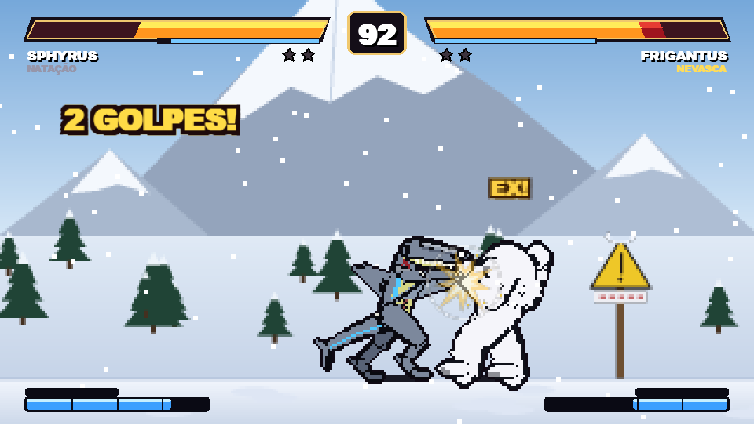
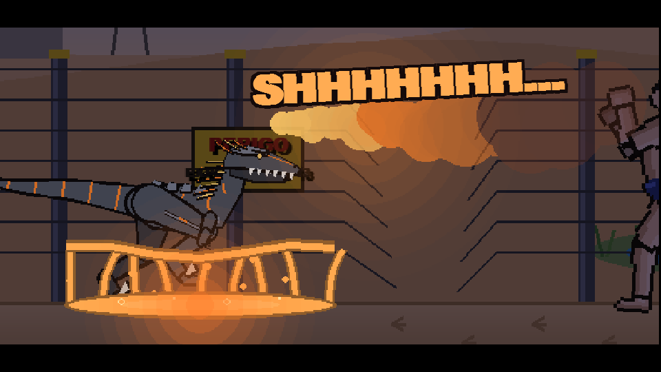
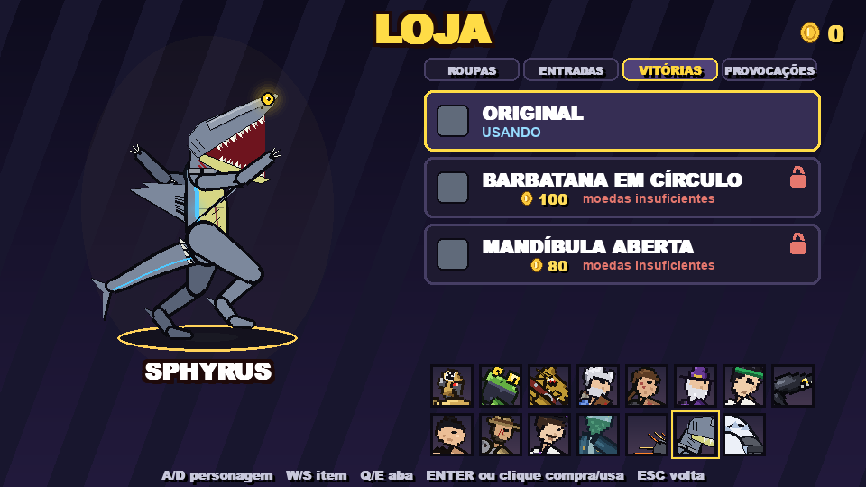
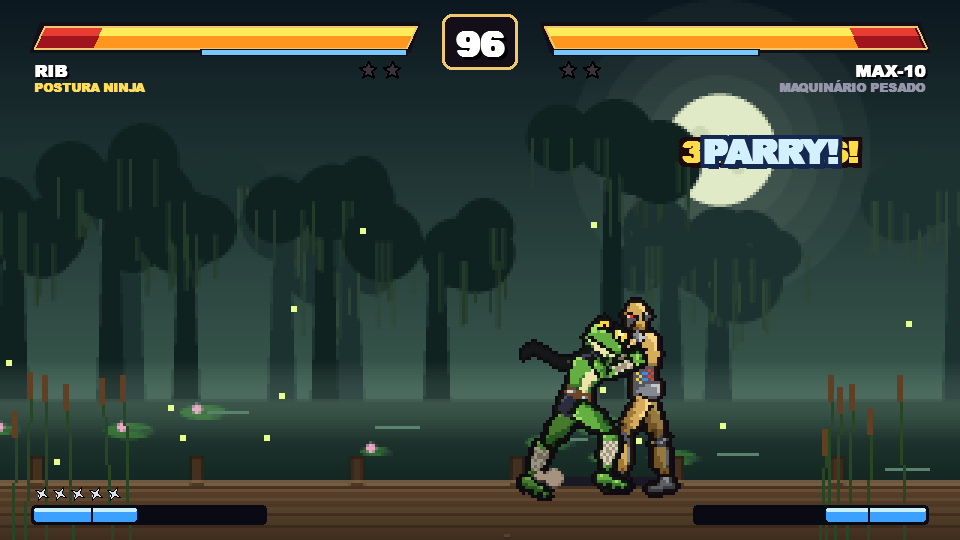

<p align="center"></p>

<h1 align="center">BATTLE WISH</h1>

<p align="center">Um jogo de luta 2D estilo Street Fighter, com 15 personagens próprios, pixel art, combos, ultimates e online com os amigos.</p>

<p align="center"><b><a href="https://github.com/ielgomesjf-web/BattleWish/releases/latest">⬇️ Baixar o jogo (Windows)</a></b></p>



## Como baixar e jogar

1. Entre em **[Releases](https://github.com/ielgomesjf-web/BattleWish/releases/latest)** e baixe o **`BattleWish.exe`**.
   É o jogo direto, sem instalar: é só abrir e jogar.
2. Na primeira vez, o Windows pode mostrar **"O Windows protegeu o computador"**. Isso acontece com qualquer jogo
   feito em casa (o arquivo não tem assinatura digital paga). Clique em **"Mais informações"** e depois em
   **"Executar assim mesmo"**.

Funciona no Windows 10 e 11. O save (moedas, roupas, troféus, figurinhas) fica num arquivo `battlewish_save.json`
do lado do jogo. Quem já jogava a 1.0 continua com tudo.

## Novidades da versão 2.0

- **5 lutadores novos**: JOHN, CRÁQUEN, MAGNUS, SPHYRUS e FRIGANTUS (agora são 15).
- **2ª ULTIMATE**: a barra agora tem uma parte AMARELA. Cheia, ela solta um golpe épico com apresentação
  dourada (cada lutador tem a sua).
- **Loja nova**: além das roupas, ENTRADAS, POSES DE VITÓRIA e PROVOCAÇÕES. As mais caras viram uma
  **cutscene de anime**.
- **PERFIL** com estatísticas, troféus e **MISSÕES DO DIA**; **MAESTRIA** de cada lutador, com títulos.
- **ÁLBUM DE FIGURINHAS**: as lutas dão figurinhas. Completou a página de um lutador, ganha a roupa
  **HOLOGRÁFICA** dele.
- **EVENTOS** que ligam sozinhos pela data: no **HALLOWEEN** os cenários ficam enfeitados e tem um **PASSE DO
  EVENTO** grátis, com doces, skins e provocações de Halloween. No **NATAL** tem meias escondidas nos cenários.
- **REI DA ARENA**, **CHOQUE** (os dois golpes batem juntos e ganha quem apertar mais), **FINISH** depois da
  ultimate, **transição de cenário** (o golpe forte joga o outro pra fora), cenários que reagem aos golpes,
  **narrador**, **MODO FOTO** e **CONFIGURAÇÕES** (volume e vibração).



## Os lutadores

| | |
|---|---|
| **MAX-10** | o robô: laser dos olhos, agarrão e metralhadora de socos |
| **RIB** | o sapo ninja: shurikens, corrida ninja, linguada e o KAGE BUNSHIN (clones jogando shuriken) |
| **TRAFO** | o cachorro mutante de seis patas: linguão que paralisa, braços que saem da terra e metralhadora de olhos |
| **KING RIP** | o mestre do nunchaku: nunchaku bumerangue, giratório e salto com nunchaku |
| **CANNAN** | o soldado: pistola, canhão de perto, corrida maluca e o FOGO TOTAL |
| **FINN** | o mago: bola de fogo, levitação, cajado e o MINI SOL (e fica invisível no combo) |
| **KUN** | o jogador de cartas: cartas, carta-espada, teleporte, e o Ás na Manga deixa os golpes mais fortes |
| **TROMOS** | o alien: cuspe de ácido, rabada, garras, rasteja e tem sangue ácido |
| **TAI** | o lutador de sumô: pisão que faz onda no chão, tapas, investida e muita armadura |
| **TAMER** | o explorador com o lobo: o lobo branco bate mais forte e o preto deixa os ataques mais rápidos |
| **JOHN** | o mágico: lâminas da cartola, teleporte com bicuda, coelho gigante e os dançarinos da ultimate |
| **CRÁQUEN** | o capitão pirata fantasma: âncora que puxa, tentáculo do polvo, espada fantasma e o NAVIO FANTASMA |
| **MAGNUS** | o raptor-robô de fogo: espinhos que prendem, rabadas, o bote e a rabada de fogo que paralisa |
| **SPHYRUS** | o tubarão-martelo: giro com onda de ar, martelada pra cima, mergulho na terra e o chão que vira MAR |
| **FRIGANTUS** | o gorila das neves: bola de neve que congela, estacas de gelo, escorregão e a AVALANCHE |

Cada um tem 4 especiais, duas ULTIMATES, uma habilidade própria, entrada, pose de vitória e roupas pra comprar na
loja. E tem segredo escondido na tela de **CÓDIGOS**: as pistas ficam lá e na loja...



## Os modos

- **1 JOGADOR**: você contra o computador (fácil, médio ou difícil).
- **2 JOGADORES**: dois no mesmo PC (o segundo precisa de um controle).
- **REI DA ARENA**: quem ganha fica, quem perde passa a vez.
- **TRIO**: 3 contra 3, trocando de lutador no meio da luta.
- **TORNEIO**: chave de 8 lutadores até a final. As lutas dos computadores dá pra assistir ou pular.
- **ONLINE**: contra um amigo em outra casa, sem precisar de VPN. Quem cria a sala escolhe o modo:
  1 contra 1, trio ou torneio (vocês 2 + 6 computadores), e pode ligar os modos malucos.
  Os dois precisam estar com a **mesma versão** do jogo (a 2.0 não joga online com a 1.0).
- **SOBREVIVÊNCIA**: um adversário atrás do outro até cair.
- **MODOS MALUCOS**: gravidade da lua, cabeções, turbo, só ultimate e um golpe mata.
- **MODO TREINO** e **COMBOS**: pra aprender os golpes e os desafios de combo de cada lutador.
- **LOJA**, **DESAFIOS** e **PERFIL**: moedas, roupas, troféus, missões e o álbum.

## Controles

Dá pra jogar no **teclado e mouse** ou no **controle de Xbox** (com fio ou bluetooth). A tela **COMO JOGAR** dentro
do jogo mostra tudo.

| Teclado e mouse | Controle | O que faz |
|---|---|---|
| A / D | direcional | andar (segurar pra trás defende) |
| W / S | cima / baixo | pular / agachar |
| botão esquerdo | A | soco |
| botão direito | B | chute |
| segura a rodinha + E, Q, R ou SHIFT | X, Y, LB, RB | os 4 especiais |
| segura a rodinha + Z | RT | ULTIMATE (com a barra azul cheia) |
| segura a rodinha + C | LT + RT | 2ª ULTIMATE (com a barra amarela cheia) |
| rodinha 2x + especial | LT + especial | especial EX (gasta barra) |
| rodinha 2x apanhando | LT apanhando | ESCAPE de combo |
| T | BACK | provocar |
| G | R3 | trocar de lutador (TRIO) |
| ESC | START | pausa |
| F11 | | tela cheia |



## Rodar pelo código

Precisa do Python 3.12 com `pygame` e `numpy`:

```
pip install pygame numpy
python luta.py
```

Os testes: `python teste.py`. Pra gerar o `.exe`: `pip install pyinstaller` e rodar o `gerar_exe.bat`
(o jogo fica na pasta `dist`).

---

Feito pelo Gomes, em Python + Pygame.
